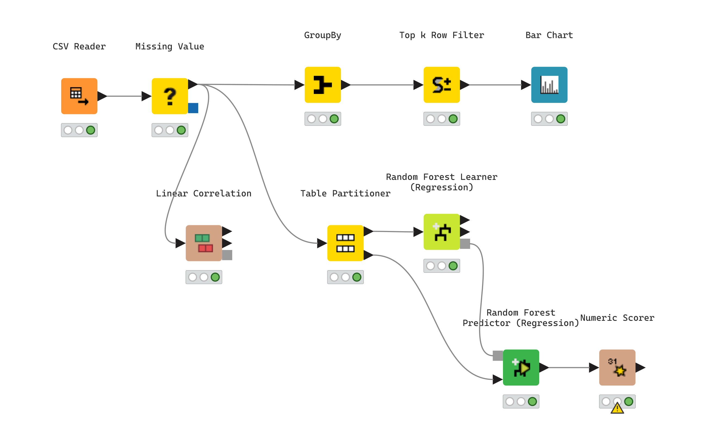
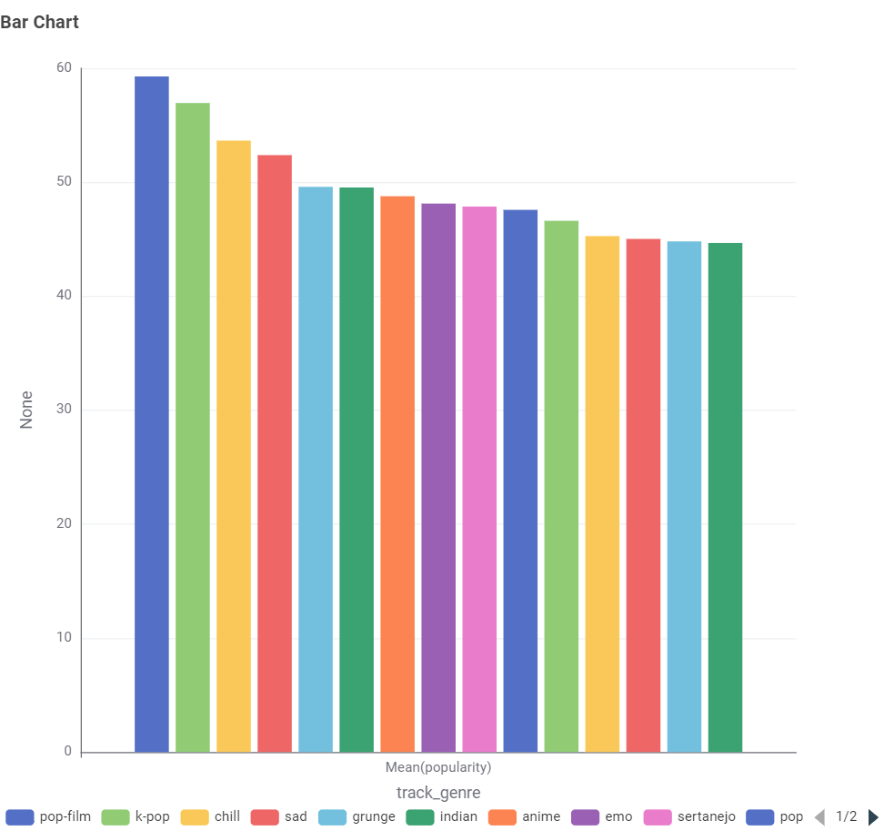
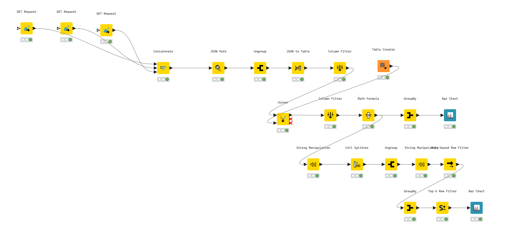
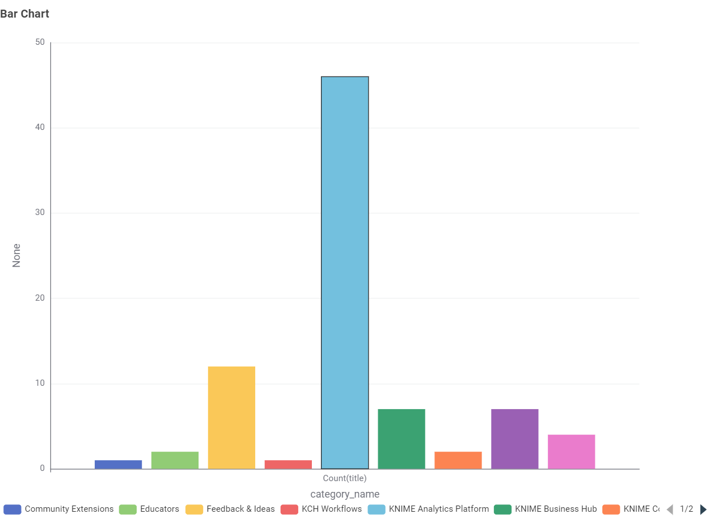
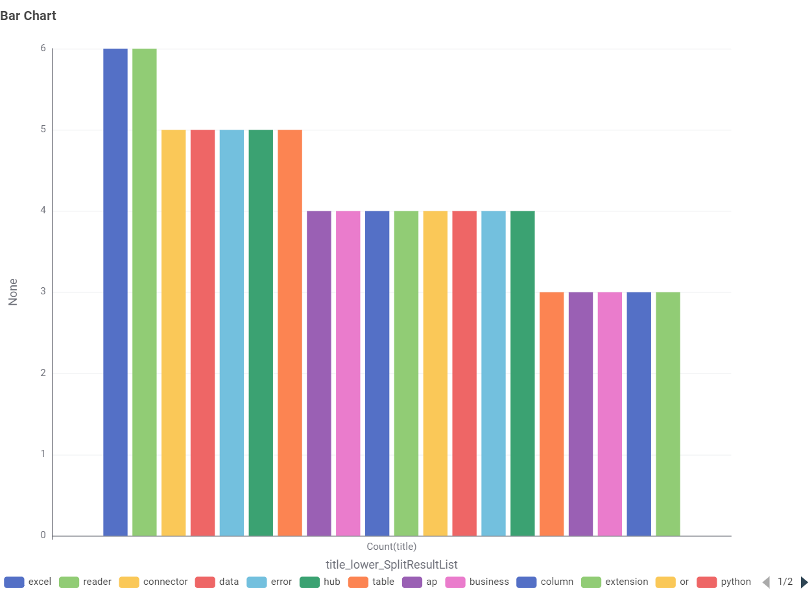

# KNIME Data Projects

Two end-to-end [KNIME Analytics Platform](https://www.knime.com/) workflows built to learn the tool hands-on: one classic data science pipeline, and one live-data project built around KNIME's own community forum.

Both workflows are also public on my KNIME Hub profile: **[hub.knime.com/tugbaates](https://hub.knime.com/tugbaates)** — open them there to explore the node graph interactively in the browser.

A detailed, step-by-step write-up with the exact node settings and reasoning behind each step is in [`docs/Tugba_Ates_KNIME_Portfolio_Detailed.pdf`](docs/Tugba_Ates_KNIME_Portfolio_Detailed.pdf). A short two-page summary is in [`docs/Tugba_Ates_KNIME_Portfolio.pdf`](docs/Tugba_Ates_KNIME_Portfolio.pdf).

---

## 1. [Spotify Tracks Analysis](spotify-tracks-analysis)

Cleans and analyzes a 114,000-song Spotify dataset, then trains a model that predicts a track's popularity from its audio features alone.

| | |
|---|---|
| **Tracks analyzed** | 114,000 (113,999 after cleaning) |
| **Model** | Random Forest Regression, 100 trees |
| **Accuracy** | R² = 0.539, MAE ≈ 10 (0–100 scale) |

**Pipeline:** `CSV Reader → Missing Value → [GroupBy → Top k Row Filter → Bar Chart]` and `[Linear Correlation]` and `[Table Partitioner → Random Forest Learner → Random Forest Predictor → Numeric Scorer]`



**Key finding — top genres by average popularity:**



Pop-film, k-pop, and chill are the most consistently popular genres. A correlation analysis of the ten numeric audio features also showed a strong positive relationship between *energy* and *loudness*, and a strong negative relationship between *energy* and *acousticness* — both musically intuitive and useful signals for the regression model.

---

## 2. [KNIME Community Forum Trend Analysis](knime-forum-trends)

Pulls live topics from KNIME's own public community forum via its Discourse API, parses the JSON, and analyzes which categories are most active and which keywords trend in recent discussion titles.

| | |
|---|---|
| **Data source** | Live public API (`forum.knime.com/latest.json`), no auth required |
| **Topics processed** | 90 → 82 after category enrichment |
| **Unique keywords extracted** | 341 |

**Pipeline:** `GET Request ×3 → Concatenate → JSON Path → Ungroup → JSON to Table → Column Filter → Joiner (+ category lookup) → Math Formula → [GroupBy → Bar Chart]` and `[String Manipulation → Cell Splitter → Ungroup → Rule-based Row Filter → GroupBy → Top k Row Filter → Bar Chart]`



**Key finding — most active categories:**



**Key finding — most frequent keywords in recent titles:**



The **KNIME Analytics Platform** category dominates recent activity by a wide margin. The most frequent keywords in topic titles — *excel, reader, connector, data, error, hub, business, python* — point to file I/O, connector configuration, and Python integration as the areas the community is currently most active around.

*(One small real-world data-quality note: a Unicode character in one post's stylized "KNIME" was stripped by the punctuation-cleaning step to "knme" and had to be added to the stop-word list by hand — a small reminder that even clean-looking text data needs a second look.)*

---

## Repository structure

```
knime-data-projects/
├── spotify-tracks-analysis/
│   └── workflow/          # KNIME workflow source (open with KNIME Analytics Platform)
├── knime-forum-trends/
│   └── workflow/          # KNIME workflow source
└── docs/                  # PDF write-ups (short + detailed)
```

Each `workflow/` folder is a standard KNIME workflow directory (`workflow.knime` + per-node `settings.xml`) with cached execution data stripped out to keep the repo lightweight — open it directly in KNIME Analytics Platform and re-execute to reproduce the results.

## About

Built by **Tuğba Ateş**, MSc Computer & Information Science student at the University of Konstanz, while learning KNIME Analytics Platform.
